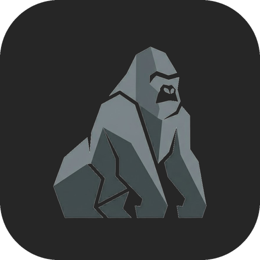
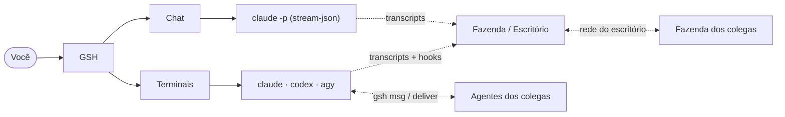

<div align="center">



# 🦍 GSH — o cockpit da Gorila para agentes de código

### Seus agentes trabalhando à vista. Terminais, chat estilo Claude Desktop e uma **fazenda pixel art** que mostra quem está trabalhando, quem precisa de você e quanto cada um gastou.

_Usa o `claude` (e o `codex`, o `agy`) da sua máquina, com o seu login. **Nenhuma chave de API passa pelo app.**_

**Terminais • Chat nativo • Fazenda / Escritório • Time na LAN • Harness • Bancos • Hosts remotos • Linux (Windows e macOS depois)**

<br/>

[](rust-toolchain.toml)
[](https://iced.rs)
[](https://code.claude.com)
[](#-baixar-e-instalar)
[](LICENSE)

[⚡ Baixar](#-baixar-e-instalar) • [💡 Recursos](#-recursos) • [🔄 Como funciona](#-como-funciona) • [🎮 Atalhos](#-atalhos) • [🧑‍💻 Desenvolver](#-desenvolver) • [🙏 Créditos](#-créditos) • [📄 Licenças](#-licenças)

</div>

---

## 🔁 Sobre este repositório

O GSH é a **reescrita em Rust** do [GSH Desktop](https://github.com/Mystic0112/GSH-Desktop) (Flutter). A regra é paridade: muda a stack, não o produto. O comportamento e a aparência saem do app Flutter, e o que ainda falta está em [`docs/parity-checklist.md`](docs/parity-checklist.md) e em [`docs/auditoria-paridade/`](docs/auditoria-paridade/).

> **🚧 Em construção.** O GSH em Rust ainda **não substitui** o GSH Desktop em Flutter. Boa parte do que está descrito abaixo já roda no Linux, mas nem tudo foi validado no uso diário, e o que está em [O que vem por aí](#o-que-vem-por-aí) **ainda não existe**. Pode quebrar, mudar e perder recurso entre versões.

Linux primeiro. Windows e macOS ficam para depois da paridade em Linux.

### ✅ Já funciona (falta validar no uso diário)

Workspaces, panes e abas · terminal local com hooks e status de turno · chat nativo · árvore de arquivos, editor e viewers · git · bancos · terminal remoto por SSH com o `gsh-server` · LocalSend e time na LAN · harness · telemetria · automações agendadas · manter acordado.

### O que vem por aí

Promessas, não recursos. Nada desta lista está pronto:

- **Tasks:** definição e execução de tasks do projeto, com histórico (existe no Flutter).
- **Workbench HTTP:** montar e rodar requisições `.http` na própria tela.
- **Cadernos `.notebook`**, quadros **`.kanban`** e painéis **`.panel`** (HTML vivo) completos.
- **Integração com Neovim.**
- **SSH remoto completo:** workspace, árvore de arquivos, git e status de agentes em hosts remotos (hoje só o terminal remoto).
- **Navegador visual** numa aba (hoje o navegador é só para agentes, sem renderizar a página para você).
- **Fazenda e escritório com paridade total:** hoje parte da pintura e do layout ainda não está integrada.
- **Ilha flutuante de agentes** no topo da janela, completa.
- **Configurações reorganizadas** como no Flutter (menu, atalhos editáveis, hosts remotos, aparência), e opções que hoje ainda não têm efeito.
- **Painel de git completo:** compositor de commit, diff e histórico no formato do Flutter.
- **Canais por contexto** com instruções, regras, membros e arquivamento.
- **Times e bots descritos em Markdown**, com fontes GitHub/pasta e versionamento.
- **Varredura do Claude Desktop** com inventário comparativo Claude Desktop/Code.
- **Modo bolsa** (alternar entre hotspot do celular e Wi-Fi com a tampa fechada), com validação em notebook real.
- **Várias contas do Claude** (perfis salvos, troca por terminal e chat) e uso do Codex.
- **CLI completa:** todos os verbos do `gsh` do Flutter (`send-key`, `list-workspaces`, `run-task`, `http`, `note`, entre outros).
- **Manter as sessões de cada workspace vivas** ao trocar de workspace (hoje o editor, o chat e os terminais são recriados).
- **App móvel / controle remoto** e catálogo OAuth.
- **Tema novo** com o visual Liquid Glass, depois que tudo estiver pronto.
- **Windows e macOS**, com pacotes e instaladores.
- **Release automático** com manifesto de atualização (hoje a release do Linux é manual).

O inventário detalhado, item por item, está em [`docs/parity-checklist.md`](docs/parity-checklist.md).

---

## 🤔 Por que o GSH?

Quem trabalha com vários agentes ao mesmo tempo perde o fio: qual terminal está esperando permissão, qual travou, qual já terminou, quanto tudo isso está custando. O GSH junta tudo num lugar só:

| Sem o GSH | Com o GSH |
| --- | --- |
| Caçar entre abas qual agente parou pedindo permissão | Fila **"precisa de você"** no topo e o gorila **amarelo** na fazenda |
| Não saber quanto cada sessão gastou | Tokens gastos por agente no hover, total do dia no HUD, **uso do plano** no chat |
| Agentes de colegas mexendo no mesmo sistema sem conversar | **Agentes do time trocando mensagens e arquivos** pela rede do escritório, com aprovação |
| Medo de um agente rodar algo em produção | **Hosts protegidos**: comando que cite `prod`, `homolog`… é bloqueado em qualquer sessão |
| Skills, hooks e MCP espalhados em mil arquivos | Aba **Harness** com tudo do projeto, avisos e quanto pesa em cada mensagem |

---

## ⚡ Baixar e instalar

> Pré-requisito: o [**Claude Code**](https://code.claude.com) instalado e logado (`claude` no terminal). Codex (`codex`) e Antigravity (`agy`) são opcionais.

Ainda não há release pública estável: o `gsh-linux-x86_64.tar.gz` (com o `SHA256SUMS`) sai de um workflow manual. Ele traz três binários:

| Binário | O que é |
| --- | --- |
| `gsh-app` | O aplicativo |
| `gsh` | A CLI interna, usada pelos agentes dentro dos terminais do app |
| `gsh-server` | O servidor para terminais em hosts remotos por SSH |

```bash
sha256sum -c SHA256SUMS
tar -xzf gsh-linux-x86_64.tar.gz
./gsh-app
```

---

## 💡 Recursos

### 🖥️ Terminais e agentes
- Panes e abas de terminal, divididos à vontade; workspaces por pasta, git, worktrees, árvore de arquivos, editor com LSP, bancos (SQLite, Postgres, MySQL, MSSQL, Mongo, Redis), tasks e navegador para agentes.
- **Status de turno** de cada agente nas abas e no rail, via hooks: trabalhando, esperando você, parado.
- Agentes falam entre si: `gsh msg --to <aba> "…"`, `gsh peers`, e o servidor MCP `gsh` para apps desktop.
- **Hosts remotos** por SSH com o `gsh-server`: sessões de terminal que sobrevivem à queda da conexão.

### 💬 Chat nativo (estilo Claude Desktop)
- Conversa com o Claude Code: permissões em cartão (**Sempre permitir** grava a regra), diffs agrupados, plano, perguntas com opções, raciocínio.
- **Anexos** e print colado com Ctrl+V; **troca de modelo**; **uso** do contexto e dos limites do plano (5 h, semana).
- Menu do **`/`** com seus agentes, skills e comandos; **Retomar conversa** de qualquer sessão recente do Claude Code.

### 🌾 Fazenda / 🏢 Escritório
- Cada **loop de agente** da máquina vira um personagem — Claude Code, Codex e Antigravity, inclusive sessões abertas fora do GSH.
- Subagentes em volta do agente principal, balão com a ferramenta atual, **barra de contexto**, tokens gastos no hover, fila **"precisa de você"**.
- Dois cenários, canteiros arrastáveis, caminhos de verdade, bichinhos 🐕 🐔 🐈.

### 👥 Time
- **Fazenda do time**: na rede do escritório, as fazendas dos colegas aparecem ao lado da sua. Sem servidor (multicast), opt-in, títulos escondidos por padrão.
- **Agentes conversando**: `gsh msg` e `gsh deliver`. A mensagem **bate na porta** do agente do colega e chega como informação de colega, não como ordem. Senha do time (HMAC) e aprovação opcional.
- **LocalSend** (protocolo v2): receber e enviar arquivos pela rede local, com confirmação.

### 🧰 Harness
- Aba por projeto com **instruções** (CLAUDE.md, AGENTS.md), **skills**, **subagentes**, **comandos**, **hooks**, **permissões** e **MCP**, cada um com o escopo (projeto, local, usuário).
- **Linter** (sem descrição, script que não existe, JSON quebrado) e **custo fixo por turno**.

### 🌐 Navegador para agentes
- `gsh browser` controla uma página por CDP com o [Obscura](https://github.com/h4ckf0r0day/obscura) (navegador headless, baixado sob demanda por `gsh browser install`). O conteúdo da página volta marcado como dado externo, nunca como instrução.

### 🛡️ Segurança
- **Hosts protegidos**: nenhum agente roda comando que cite um host da lista, em qualquer sessão e modo de permissão.
- Mensagens entre agentes de colegas só entram em abas com agente rodando, assinadas e com aprovação opcional.

---

## 🔄 Como funciona



- O motor é sempre o **CLI da sua máquina** com o seu login. O GSH não fala com a API da Anthropic.
- A fazenda lê os **transcripts** que o próprio Claude Code / Codex gravam, e os **hooks** do `gsh` contam quem está esperando você.
- A CLI interna **`gsh`** conversa com o app por um socket local (`GSH_STATUS_SOCK`) e só aparece dentro dos terminais que o app abre.

---

## 🎮 Atalhos

| Atalho | Ação |
| --- | --- |
| `Ctrl+T` | Novo terminal |
| `Ctrl+Shift+L` | Novo chat |
| `Ctrl+D` / `Ctrl+Shift+D` | Dividir à direita / abaixo |
| `Ctrl+P` | Ir para arquivo |
| `Ctrl+F` | Buscar no arquivo |
| `Ctrl+Shift+F` | Buscar nos arquivos |
| `Ctrl+1…9` | Ir para a aba |

Os atalhos são configuráveis na seção `[shortcuts]` do arquivo de configuração.

---

## 🧑‍💻 Desenvolver

**Pré-requisitos:** Rust (o toolchain *stable*, com `rustfmt` e `clippy`, é fixado em [`rust-toolchain.toml`](rust-toolchain.toml)) e o `claude` logado.

```bash
cargo run -p gsh-app
```

Antes de commitar:

```bash
cargo fmt --all --check
cargo clippy --workspace --all-targets -- -D warnings
cargo test --workspace
```

O workspace proíbe `unwrap`, `expect`, `panic` e indexação direta (`v[i]`) fora de testes; use `.get()` e erros tipados.

| Crate | O que é |
| --- | --- |
| `crates/app` (`gsh-app`) | O aplicativo (iced): shell, panes, chat, fazenda, harness, time, configurações |
| `crates/cli` (`gsh`) | CLI interna: hooks, mensagens entre agentes, MCP, comandos de aba, `db`, `browser` |
| `crates/core` | Domínio puro, sem I/O nem UI |
| `crates/term` | Terminal: PTY (`portable-pty`) e emulador (`alacritty_terminal`) |
| `crates/chat` | Motor do chat sobre `claude` em `stream-json` |
| `crates/editor`, `crates/search`, `crates/git` | Editor com LSP, busca, git |
| `crates/db` | Drivers de SQLite, Postgres, MySQL, MSSQL, Mongo e Redis |
| `crates/harness`, `crates/telemetry`, `crates/config` | Harness do projeto, telemetria, configuração |
| `crates/team`, `crates/localsend` | Time na LAN e LocalSend |
| `crates/browser` | Navegador para agentes (CDP/Obscura) |
| `crates/ipc`, `crates/server` | Protocolo CLI↔app e `gsh-server` para hosts remotos |

Decisões de arquitetura em [`docs/adr/`](docs/adr/).

### 🚀 Soltar uma versão

O workflow manual [`release-linux.yml`](.github/workflows/release-linux.yml) compila `gsh-app`, `gsh` e `gsh-server` e gera o `gsh-linux-x86_64.tar.gz` com o `SHA256SUMS`. Ele ainda não publica a release sozinho.

---

## 🙏 Créditos

- Fork do **[Cockpit](https://github.com/jacobaraujo7/remote_pi)** (Remote Pi), de Jacob Moura — MIT.
- Mundo pixel art da fazenda portado do **[clodfarm](https://github.com/matank001/clodfarm)** — MIT ([licença](third_party/clodfarm/LICENSE)).
- Escritório inspirado no **[habblaud](https://github.com/marmottajr/habblaud)**; ideias do **[pixel-agents](https://github.com/pixel-agents-hq/pixel-agents)** e do **[Harness²](https://github.com/google-research/harness2)** — arte e código do GSH são próprios.
- Ícones de arquivo por extensão do **[material-icon-theme](https://github.com/material-extensions/vscode-material-icon-theme)** — MIT.

## 📄 Licenças

O GSH é distribuído sob a licença **MIT** — veja [`LICENSE`](LICENSE). Os componentes de terceiros mantêm as licenças deles:

| Componente | Licença | Onde |
| --- | --- | --- |
| Cockpit (Remote Pi), de Jacob Moura | MIT | [`LICENSE`](LICENSE) |
| clodfarm (mundo da fazenda) | MIT | [`third_party/clodfarm/LICENSE`](third_party/clodfarm/LICENSE) |
| Material Symbols (ícones da interface) | Apache-2.0 | [`LICENSE-MaterialSymbols.txt`](crates/app/assets/fonts/LICENSE-MaterialSymbols.txt) |
| Hanken Grotesk | OFL-1.1 | [`OFL-HankenGrotesk.txt`](crates/app/assets/fonts/OFL-HankenGrotesk.txt) |
| JetBrains Mono | OFL-1.1 | [`OFL-JetBrainsMono.txt`](crates/app/assets/fonts/OFL-JetBrainsMono.txt) |
| Montserrat | OFL-1.1 | [`OFL-Montserrat.txt`](crates/app/assets/fonts/OFL-Montserrat.txt) |
| material-icon-theme (ícones de arquivo) | MIT | `crates/app/assets/file_icons/` |
| Obscura (navegador headless) | Apache-2.0 | Não vai no pacote: baixado sob demanda de [h4ckf0r0day/obscura](https://github.com/h4ckf0r0day/obscura) |

**Dependências Rust.** As crates do `Cargo.lock` são todas de licença permissiva (MIT, Apache-2.0, BSD, ISC, Zlib, Unicode-3.0, entre outras), sem copyleft forte. Os casos que merecem atenção:

- `option-ext` — **MPL-2.0** (copyleft por arquivo; usada sem modificação).
- `self_cell` — `Apache-2.0 OR GPL-2.0-only`: o GSH usa pela opção Apache-2.0.
- `webpki-roots` — CDLA-Permissive-2.0 (lista de certificados raiz).

Para listar tudo com versão e licença:

```bash
cargo install cargo-license && cargo license
```

Os logos dos agentes em `crates/app/assets/harness_icons/` (Claude Code, Codex, Antigravity, Cursor, GitHub Copilot, OpenCode, Pi) pertencem aos respectivos donos e aparecem só para identificar cada ferramenta.

<div align="center">
<br/>
<sub>Feito pela <a href="https://gorilash.com.br">Gorila Software House</a> 🦍</sub>
</div>
